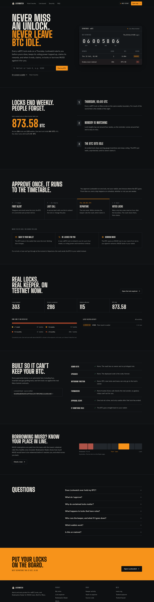
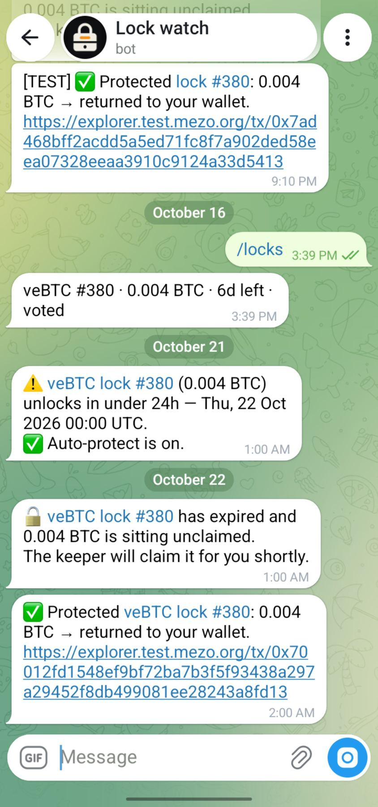
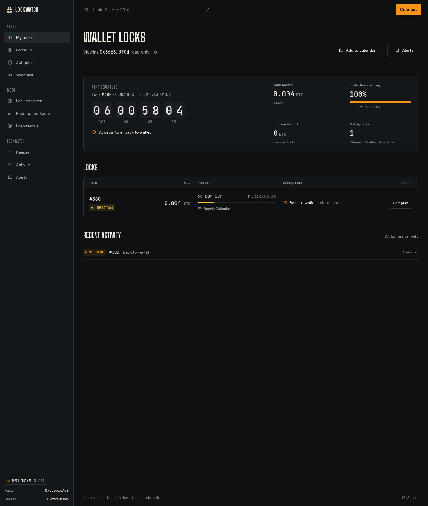
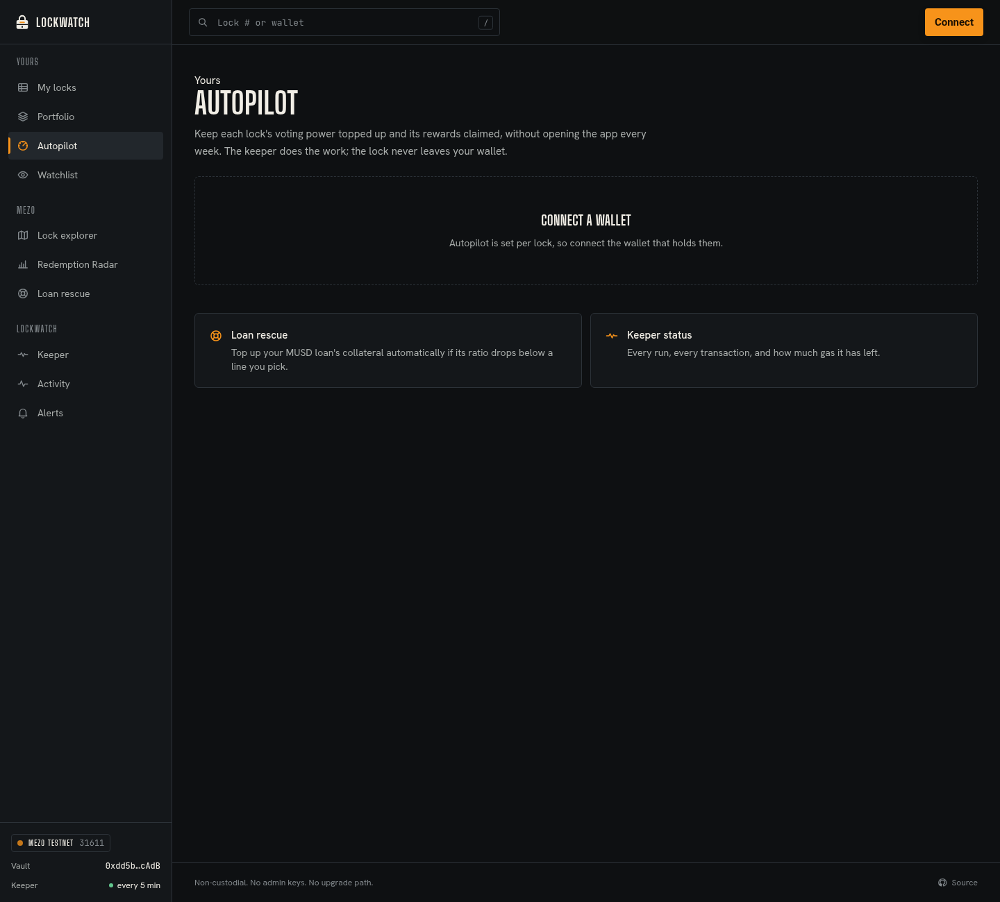
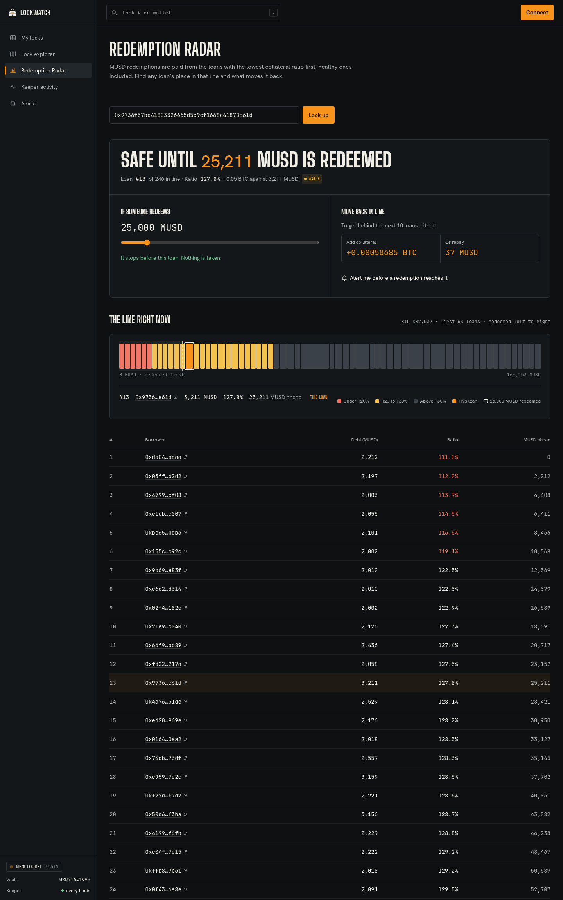
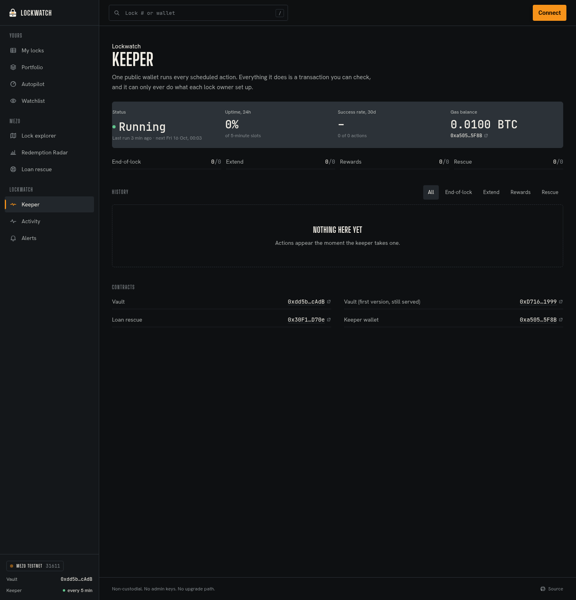
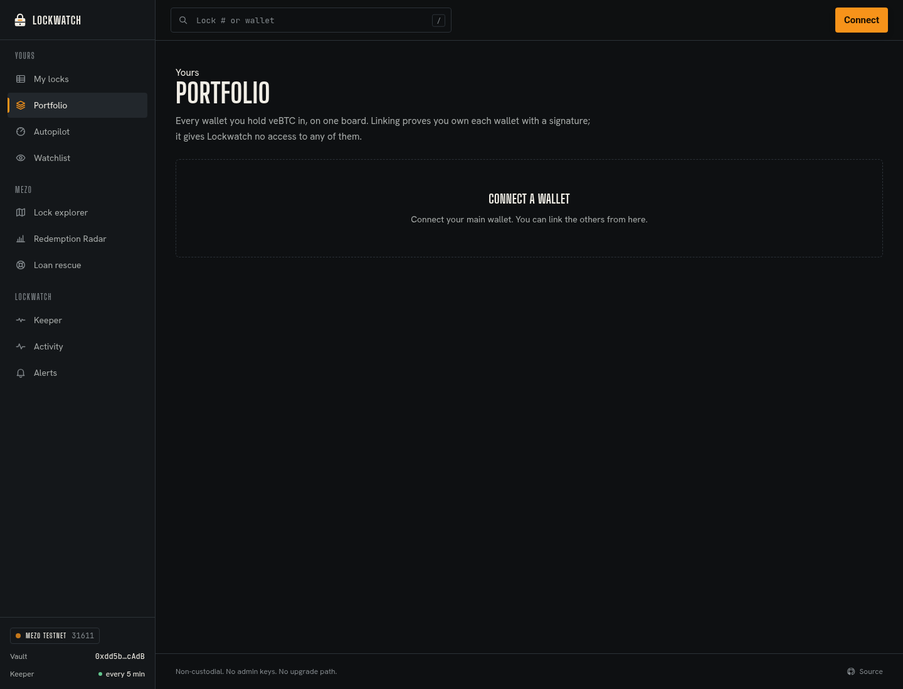
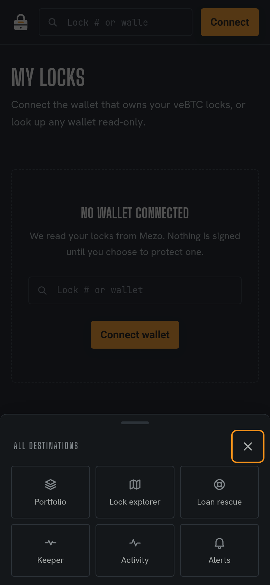
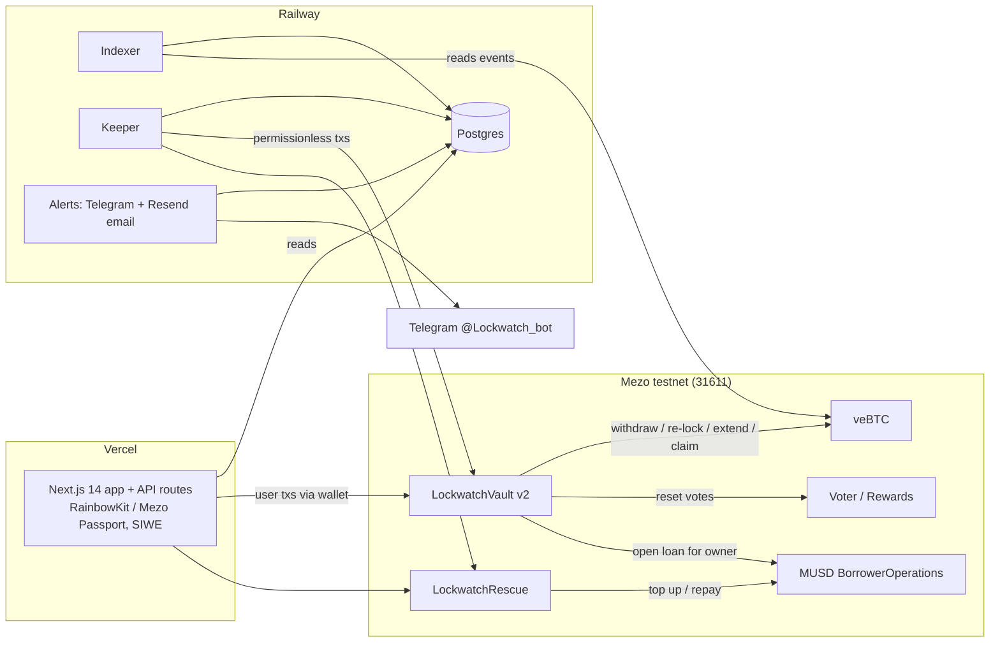

<p align="center"></p>
<h1 align="center">Lockwatch</h1>
<p align="center"><b>NEVER MISS AN UNLOCK.<br/>NEVER LEAVE BTC IDLE.</b></p>
<p align="center">Expiry protection for <b>veBTC and veMEZO</b> locks on Mezo: alerts before a lock ends, a keeper that acts the moment it does, and a Redemption Radar for MUSD borrowers.</p>
<p align="center"><a href="https://lockwatch.online"><b>Live demo: lockwatch.online</b></a> · Telegram: <a href="https://t.me/Lockwatch_bot">@Lockwatch_bot</a> · Mezo testnet (chain 31611)</p>



## Live proof: auto-protect, end to end
veBTC lock **#380 (0.004 BTC)** on Mezo testnet expired on Thu 22 Oct 2026 at 00:00 UTC. The owner did nothing:

| When (UTC) | What happened |
|---|---|
| Oct 21, 00:00 | Telegram: 24h warning, "Auto-protect is on" |
| Oct 22, 00:00 | Lock expires. Telegram: the keeper will claim it |
| Oct 22, 01:00 | Keeper calls `LockwatchVault.protectBatch`: votes reset, lock withdrawn, **0.004 BTC sent to the owner**. Telegram: "Protected veBTC lock #380: 0.004 BTC → returned to your wallet" |

Tx: [0x70012fd1…a8fd13](https://explorer.test.mezo.org/tx/0x70012fd1548ef9bf72ba7b3f5f93438a297a29452f8db499081ee28243a8fd13) (block 16289643, status success). The vault ended the transaction holding no BTC.

<p align="center"></p>

## Built on MEZO and MUSD
- **veMEZO, first-class.** Every veMEZO lock is indexed alongside veBTC. Its own vault instance ([0x24fd…27ae](https://explorer.test.mezo.org/address/0x24fd63DE4274c71B51cA08adEd519B6cC72f27ae), verified) returns MEZO to the owner at expiry or re-locks it for up to 4 years. Auto-extend keeps boost weight at the 4-year max, and reward auto-claim collects BoostVoter bribes. The UI has a veBTC / veMEZO switch on every lock view, with MEZO totals kept separate from BTC.
- **MUSD.** Expired veBTC can open an MUSD loan in the owner's name, Loan Rescue defends MUSD troves, and the Redemption Radar shows each borrower's place in the redemption queue.

## The problem
Every veBTC lock on Mezo ends on a Thursday at 00:00 UTC, and holders forget. An ended lock stops earning and stops voting, and its BTC sits idle until the owner remembers to come back and claim it.

The evidence is onchain. We scanned every veBTC id on Mezo testnet (1–379, Oct 15 2026): **286 locks were expired and unclaimed, holding 873.58 testnet BTC**, effectively the whole veBTC supply. veMEZO has the same problem: of 920 veMEZO ids, **129 locks are expired and unclaimed, holding 80,500 testnet MEZO** (scan Oct 16 2026). Nobody is watching those positions. Expired positions are also the ones attackers look for: an Oct 5, 2026 incident on Mezo involved expired locks.

Borrowers have a matching blind spot. MUSD redemptions hit the lowest-collateral troves first, and a borrower can't easily see where they are in that line.

## What Lockwatch does
| Feature | What it does |
|---|---|
| 🟦 **veMEZO support** | The same guard for veMEZO: index, alerts, at-risk explorer, auto-protect (MEZO back to you or re-locked up to 4 years), auto-extend to the 4-year max, BoostVoter bribe auto-claim, calendar, watchlist and portfolio. MUSD outcomes stay BTC-only. |
| ⏳ **Expiry Guard + auto-protect** | Watch every lock you own with a live countdown. Approve one lock and pick an outcome. At expiry a permissionless keeper resets votes and withdraws, then **returns the BTC to you, re-locks it in your name, or opens an MUSD loan in your name**. If anything fails, the BTC goes back to you. The vault never holds BTC after a transaction. |
| 🔁 **Auto-extend** | Keep a lock alive forever: when it gets within your chosen window of expiry, the keeper extends it by your chosen duration. |
| 💸 **Rebase auto-claim** | Weekly rebases from the veBTC and veMEZO RewardsDistributors are claimed for every lock with a balance above a dust threshold, through the permissionless `claim`/`claimMany`. A live lock gets the rebase compounded into it; an expired lock's owner is paid directly. The keeper never touches the funds. Claims show in Activity and on the Keeper page. |
| 🎁 **Reward auto-claim** | The keeper claims voting rewards for opted-in locks and sends them to the owner. |
| 🛟 **Loan rescue** | Set a collateral-ratio line on your MUSD trove with a signed rule. If it drops below, the keeper tops up collateral and/or repays from your pre-approved amounts. |
| 📡 **Redemption Radar** | Borrower-side: your place in the MUSD redemption queue, MUSD ahead of you, "what if X MUSD is redeemed", and the top-up or repayment that moves you back. |
| 🗺 **BTC-at-risk explorer** | Every expired, unclaimed lock on Mezo, by size and age. |
| 📅 **Calendar export** | A personal iCal feed with every unlock date, so it lands in your own calendar. |
| 👀 **Watchlist** | Follow any lock or wallet without owning it. |
| 👛 **Multi-wallet portfolio** | Link several wallets with a SIWE signature and see every lock in one view. |
| 🤖 **Keeper page** | Public keeper status: every run, every transaction, success rate and remaining gas. |
| 🔔 **Telegram + email alerts** | 7 days, 1 day, at expiry, and when protection succeeds or fails. |

| | |
|---|---|
|  |  |
|  |  |
|  |  |

More in [docs/screenshots](docs/screenshots).

## Architecture


- **contracts/**: Foundry, solc 0.8.28. `LockwatchVault` (auto-protect, auto-extend, reward claim) and `LockwatchRescue` (signed loan-rescue rules). No admin withdraw path, no trusted forwarder: every call checks the real sender.
- **services/**: one Railway worker running the indexer, keeper and alert sender against Postgres.
- **apps/web/**: Next.js 14 app and API routes on Vercel.
- **packages/**: shared SDK (ABIs, addresses, typed data) and the DB layer.

## Contracts (Mezo testnet, verified)
| Contract | Address |
|---|---|
| LockwatchVault v2 | [0xdd5baB25b65C4697A2e14F47B919B61416A0cAdB](https://explorer.test.mezo.org/address/0xdd5baB25b65C4697A2e14F47B919B61416A0cAdB) |
| LockwatchRescue | [0x4408e3348584d37a4412B0BeEF71a3e97Fd32f64](https://explorer.test.mezo.org/address/0x4408e3348584d37a4412B0BeEF71a3e97Fd32f64) |
| LockwatchRescue (superseded, pre-CEI fix) | [0x30F1f216f36E102663BCCE4b49eE18C25bE3D70e](https://explorer.test.mezo.org/address/0x30F1f216f36E102663BCCE4b49eE18C25bE3D70e) |
| LockwatchVault v1 (still serves lock #380) | [0xD7160697f3ACd0191e65bcccaAFeaa0913D21999](https://explorer.test.mezo.org/address/0xD7160697f3ACd0191e65bcccaAFeaa0913D21999) |
| LockwatchVault (veMEZO instance: RETURN / RELOCK, 4-year max) | [0x24fd63DE4274c71B51cA08adEd519B6cC72f27ae](https://explorer.test.mezo.org/address/0x24fd63DE4274c71B51cA08adEd519B6cC72f27ae) |
| veMEZO (Mezo) | [0xaCE816CA2bcc9b12C59799dcC5A959Fb9b98111b](https://explorer.test.mezo.org/address/0xaCE816CA2bcc9b12C59799dcC5A959Fb9b98111b) |
| veBTC (Mezo) | [0xB63fcCd03521Cf21907627bd7fA465C129479231](https://explorer.test.mezo.org/address/0xB63fcCd03521Cf21907627bd7fA465C129479231) |

## Proof: real testnet transactions
| Step | Transaction |
|---|---|
| **Keeper auto-extended lock #381 on its own (unlock moved Oct 22 → Nov 19)** | [0x4515f54e…acbe7b](https://explorer.test.mezo.org/tx/0x4515f54e3876b980c083b938f062e2db9839fd1b16480a43571bcddddeacbe7b) |
| Create lock #381 | [0xd11b9fc6…fbffc1](https://explorer.test.mezo.org/tx/0xd11b9fc6f58187eb814c5c2aac6bc53951b063710807ac3b7b2e1edbd7fbffc1) |
| Approve lock #381 to the vault | [0x74461bea…fb317](https://explorer.test.mezo.org/tx/0x74461bea1fc2be01adaa5e1a28d893b1c6dd2214dded9edc7482c713120fb317) |
| Set auto-extend policy | [0x67807143…ec403](https://explorer.test.mezo.org/tx/0x67807143d05346fb8e7a9bc97e38ecd7d9794222c6e2b4e87a8a3f78669ec403) |
| Turn on reward auto-claim (#381) | [0xe3794b80…c5802](https://explorer.test.mezo.org/tx/0xe3794b80ab0a5a2ecb733eecffdb650230090b436328d75fe16fda2f6c1c5802) |
| Approve vault v2 for the e2e wallet | [0x1694c457…ee4d4](https://explorer.test.mezo.org/tx/0x1694c457c4bc091c4e5874ba931bca198f68cce1d64af3645e7d4e66829ee4d4) |
| Turn on reward auto-claim (#380) | [0xf50d41d8…e9bcb](https://explorer.test.mezo.org/tx/0xf50d41d89b07cc51a97c944dcd8a9c2f1c17ef6b6e3f30e372939698e96e9bcb) |

Also verified live on lockwatch.online with real wallet signatures: calendar feed, watchlist, multi-wallet linking (a replayed signature is rejected), settings readback, and Telegram + email alert delivery.

## Testing
| Suite | Tests |
|---|---|
| Contracts (Foundry: unit, fuzz, invariant, gas-griefing, veMEZO instance) | 73 |
| Contracts, fork tests against live Mezo testnet (veBTC + real VeMEZO/BoostVoter + veMEZO RewardsDistributor rebase claims) | 17 |
| Services (indexer, keeper, alerts, both ledgers, rebase auto-claim) | 40 |
| Web (API routes, UI, mobile nav, gas padding, asset switch) | 48 |
| SDK | 30 |
| DB | 13 |
| **Total** | **221, all passing** |

Plus `services/scripts/fork-e2e.ts` (full keeper flow on a fork of testnet), `services/scripts/fork-e2e-mezo.ts` (production indexer + keeper on the veMEZO ledger against the deployed veMEZO vault: auto-extend to ~4 years, then 2,500 MEZO returned to the owner at expiry) and `services/scripts/live-e2e.ts` (real transactions above).

```bash
pnpm test                 # all TS suites
pnpm test:contracts       # Foundry
pnpm test:fork            # Foundry against https://rpc.test.mezo.org
```

## Quickstart
```bash
pnpm install
cp .env.example .env
pnpm --filter @lockwatch/web dev          # app on :3000
pnpm --filter ./services start            # indexer + keeper + alerts
```
Requires Node 20+, pnpm, Postgres, and Foundry for contracts.

### Environment variables (names only)
- **Web:** `NEXT_PUBLIC_CHAIN_ID`, `NEXT_PUBLIC_LOCKWATCH_VAULT`, `NEXT_PUBLIC_LOCKWATCH_VAULT_MEZO`, `NEXT_PUBLIC_LOCKWATCH_RESCUE`, `NEXT_PUBLIC_KEEPER_ADDRESS`, `NEXT_PUBLIC_WALLETCONNECT_PROJECT_ID`, `NEXT_PUBLIC_TELEGRAM_BOT`, `DATABASE_URL`, `SIWE_DOMAIN`, `APP_URL`, `KEEPER_BALANCE_RPC`, `TYPICAL_REDEMPTION_MUSD`
- **Worker:** `DATABASE_URL`, `RPC_URL`, `TELEGRAM_BOT_TOKEN`, `TELEGRAM_MODE`, `TELEGRAM_WEBHOOK_SECRET`, `RESEND_API_KEY`, `EMAIL_FROM`, `APP_URL`, `PORT`, `KEEPER_PRIVATE_KEY`, `LOCKWATCH_VAULT_MEZO` (optional override), `REBASE_DISTRIBUTOR`, `REBASE_DISTRIBUTOR_MEZO`, `REBASE_MIN_BTC`, `REBASE_MIN_MEZO` (optional overrides)

## Honest limitations
- **veBTC rebases are paused upstream.** The veBTC RewardsDistributor hasn't been funded since Nov 2025, so the keeper finds nothing to claim there. veMEZO rebases are live and get claimed.
- **Locks of size zero are left out of at-risk counts.** Ids whose balance was merged or split away hold nothing, so they're no longer counted as idle.
- **Loan rescue triggers on collateral ratio only.** It does not yet react to redemption-queue position; the Radar shows that, but rescue doesn't act on it.
- **No sMUSD savings vault on testnet.** The "MUSD → savings" outcome is mainnet-only; on testnet the MUSD outcome stops at opening the loan.
- **One vault approval per lock.** veBTC allows one approved address per lock, so approving a lock for Vault v2 replaces its approval for the old vault (lock #380 stays on v1 for that reason).
- Loan rescue and a live expiry withdrawal are proven in fork tests; the live run didn't trigger them because no test trove fell below its line and no lock had yet expired.

- **veMEZO keeper action is proven on a fork, not live.** Testnet MEZO has no public faucet (the Mezo faucet is captcha-gated and gives BTC), so no team wallet holds MEZO for a live lock. The deployed veMEZO vault is exercised on an anvil fork of testnet by the production keeper code.
- **Vault v2 (veBTC) runs the previous vault revision.** The current source only makes fee claims optional and rejects MUSD modes when no MUSD wiring exists; veBTC behaviour is unchanged, so v2 was not redeployed.

## License
Apache-2.0
