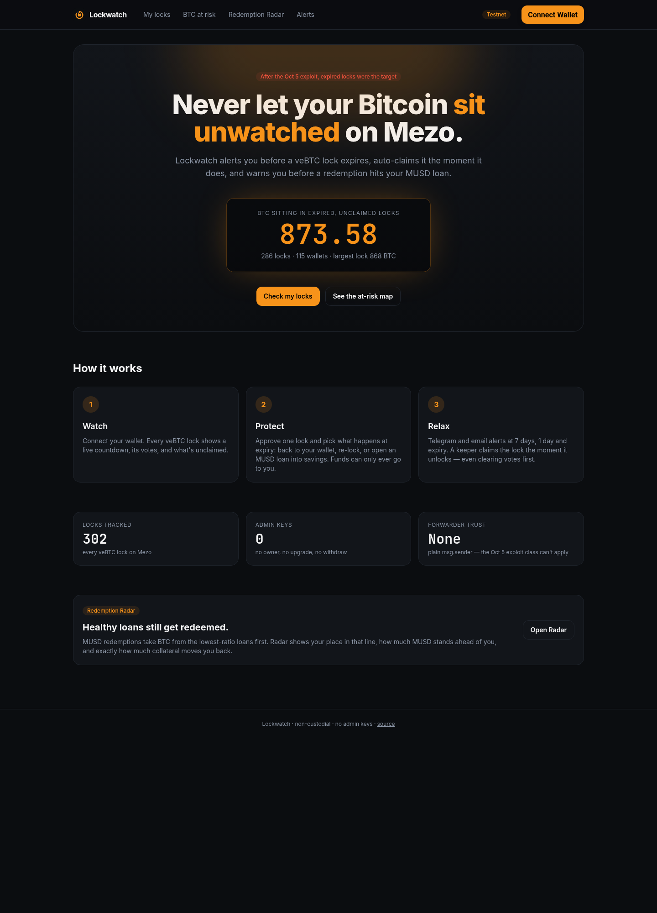
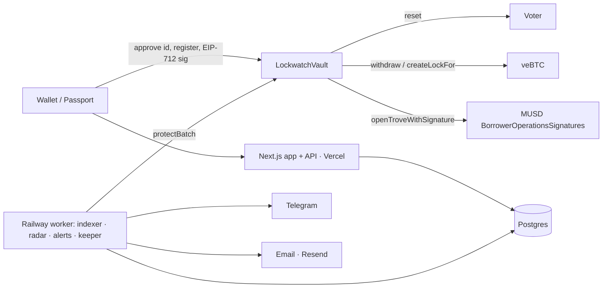
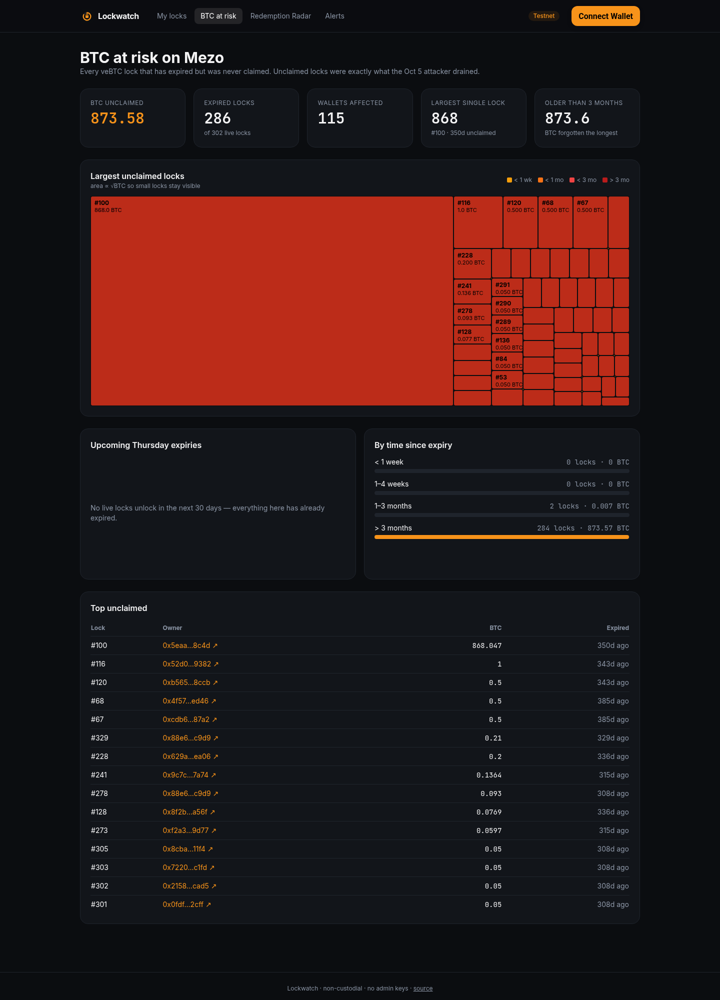
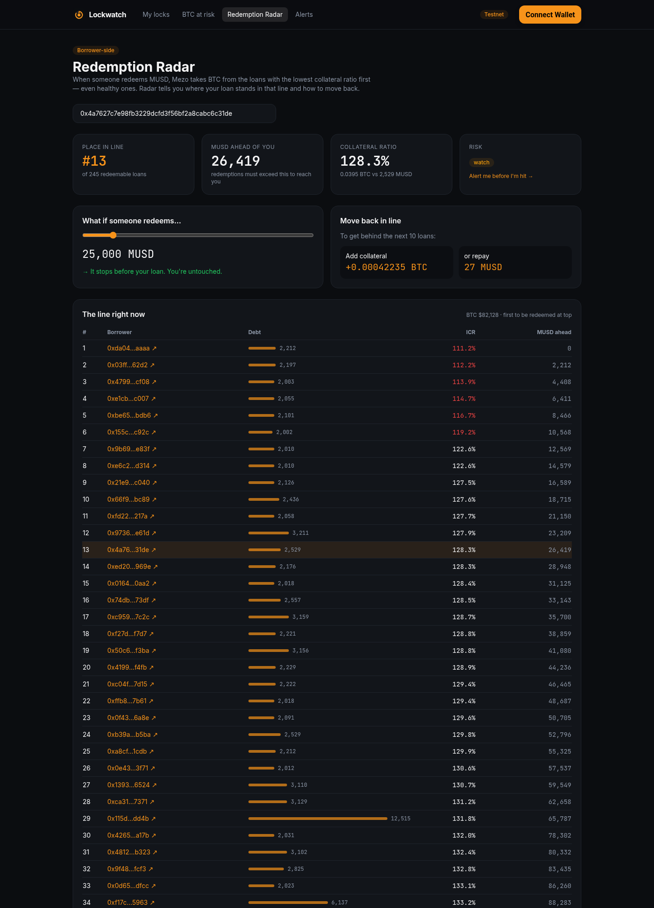
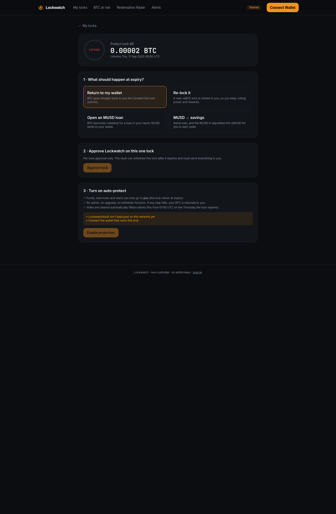
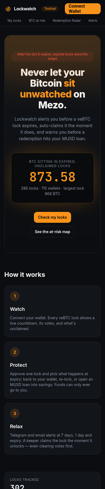

<p align="center"></p>
<h1 align="center">Lockwatch</h1>
<p align="center"><b>Never let your Bitcoin sit unwatched on Mezo.</b><br/>Expiry alerts + auto-protect for veBTC locks, and borrower-side Redemption Radar for MUSD loans.</p>



## Why
Every veBTC lock on Mezo ends on a Thursday, and holders forget. An ended lock stops earning and voting, and its BTC just sits there until the owner remembers to claim it. Lockwatch watches for that and keeps the BTC working: alerts, auto-claim, re-lock or MUSD. On testnet today, **286 of 302 live locks are expired and unclaimed**.

## What it does
| | |
|---|---|
| ⏳ **Watch** | Every veBTC lock you own, with a live countdown, votes and protection status |
| 🛡 **Auto-protect** | Approve one lock, pick an outcome. At expiry a permissionless keeper clears votes, withdraws, and **returns the BTC to you, re-locks it in your name, or opens an MUSD loan in your name** (→ sMUSD savings on mainnet). Anything fails → BTC back to you |
| 🔔 **Alerts** | Telegram + email at 7 days, 1 day, expiry, protect done/failed |
| 🗺 **BTC-at-risk map** | Every expired, unclaimed lock on Mezo by size and age |
| 📡 **Redemption Radar** | *Borrower-side*: your place in the MUSD redemption line, MUSD ahead of you, "what if X MUSD is redeemed", and the collateral/repay that moves you back — with alerts before you're hit. (TrovePilot serves redeemers; Radar protects borrowers.) |



## Safety
No owner, no admin, no upgrade, no withdraw function, no forwarder trust. Funds can only reach the lock owner. See [SECURITY.md](SECURITY.md) — every guarantee is a test, including a gas-griefing regression test.

| Screens | |
|---|---|
|  |  |
|  |  |

## Repo
```
contracts/   Foundry · LockwatchVault.sol (solc 0.8.28, evm london) · unit/fuzz/invariant/fork tests
packages/sdk viem chains, addresses, ABIs, epoch math, radar math, EIP-712 builders
packages/db  Postgres / PGlite schema + queries
services/    Railway worker: indexer, keeper, radar, alerts, Telegram bot (Dockerfile, railway.json)
apps/web     Next.js 14 · React 18 · Mezo Passport · Tailwind · Recharts
docs/        OPEN-QUESTIONS.md, DEMO.md, screenshots, ci.yml (move to .github/workflows/ — push token lacked `workflow` scope)
```

## Run
```bash
pnpm install
pnpm test:contracts                 # 35 tests: unit, fuzz, invariant, gas-griefing
pnpm test:fork                      # 5 tests against real Mezo testnet contracts
pnpm test                           # sdk, db, services, web
cd services && DATABASE_URL=../.data/pglite pnpm scan   # read-only scan of testnet into local DB
cd apps/web && DATABASE_URL=../../.data/pglite pnpm build && pnpm start
```
Deploy: `forge script contracts/script/Deploy.s.sol --rpc-url mezo_testnet --broadcast`, then set `LOCKWATCH_VAULT` / `NEXT_PUBLIC_LOCKWATCH_VAULT` (see `.env.example`).

## Deployments

| Network | LockwatchVault |
|---|---|
| Mezo testnet (31611), vault v2 | [`0xdd5baB25b65C4697A2e14F47B919B61416A0cAdB`](https://explorer.test.mezo.org/address/0xdd5baB25b65C4697A2e14F47B919B61416A0cAdB) |
| Mezo testnet (31611), loan rescue | [`0x30F1f216f36E102663BCCE4b49eE18C25bE3D70e`](https://explorer.test.mezo.org/address/0x30F1f216f36E102663BCCE4b49eE18C25bE3D70e) |
| Mezo testnet (31611), vault v1 (still served by the keeper) | [`0xD7160697f3ACd0191e65bcccaAFeaa0913D21999`](https://explorer.test.mezo.org/address/0xD7160697f3ACd0191e65bcccaAFeaa0913D21999) (source verified) |

Wallet connection uses the standard RainbowKit modal with Mezo Passport's Bitcoin wallets (Unisat, OKX, Xverse) as an extra group. Set `NEXT_PUBLIC_WALLETCONNECT_PROJECT_ID` to enable WalletConnect-based wallets; without it, browser/extension wallets still work.

## Testnet addresses
veBTC `0xB63f…9231` · Voter `0x72F8…5738` · BorrowerOperationsSignatures `0xD757…639e` · sMUSD (mainnet) `0xb4D4…51CC` — full list in `packages/sdk/src/addresses.ts`.

Apache-2.0
